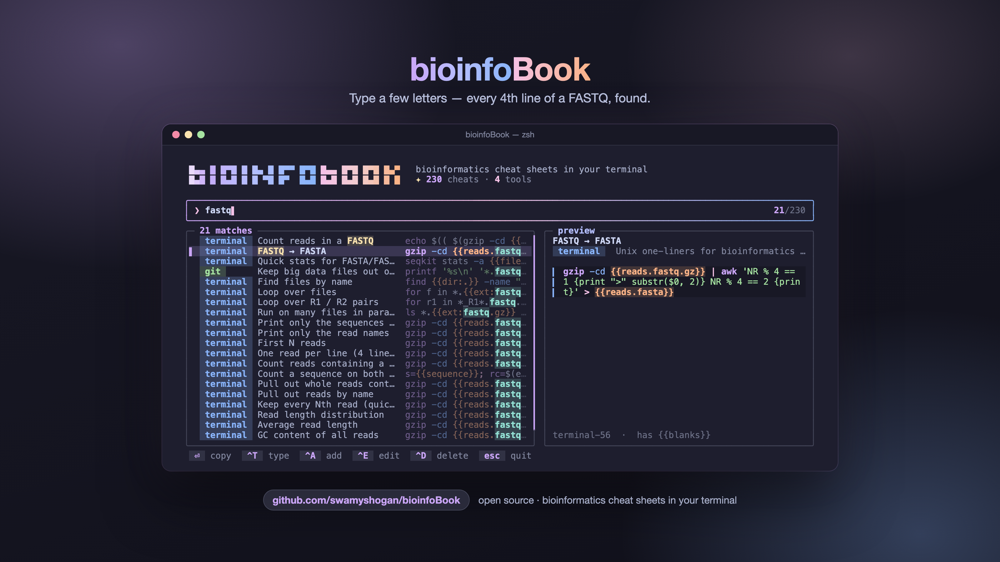
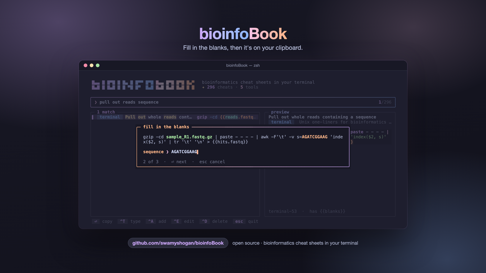
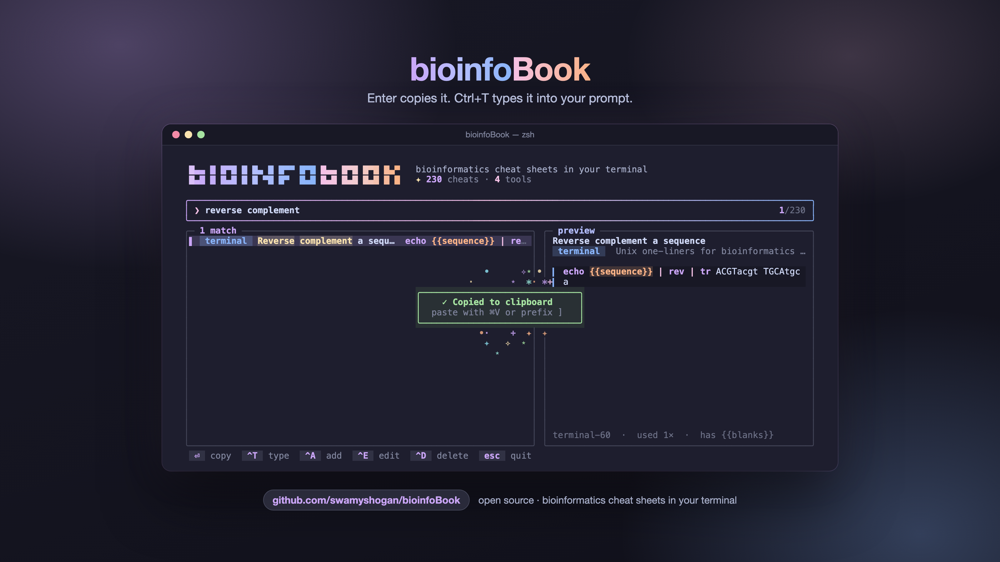

# bioinfoBook ✦

**Bioinformatics cheat sheets in your terminal: animated, colourful, and written by the community.**

Stop digging through old notebooks and Stack Overflow tabs for that one `awk` line that prints every 4th line of a FASTQ. Type a few letters, press Enter, and the command is on your clipboard, with the blanks filled in.

<sub>Ideation by **Shogan** · Executed by **Claude**</sub>



<table>
  <tr>
    <td></td>
    <td></td>
  </tr>
  <tr>
    <td align="center"><sub>Fill in the blanks</sub></td>
    <td align="center"><sub>Copied, with a little sparkle</sub></td>
  </tr>
</table>

## Features

- **Search as you type.** Fuzzy matching on titles, commands and notes. `#samtools` limits the search to one tool.
- **Copy or type it in.** Enter copies to your clipboard and tmux buffer. `Ctrl+T` types the command into your prompt so you can edit it before running.
- **Fill in the blanks.** Cheats like `samtools sort -@ {{threads:4}} -o {{out.bam}}` ask for each value before copying.
- **Your own private cheats.** Save the commands you use often (your cluster login, your lab's pipeline) with a description to search by. They stay on your computer and are never part of the repo.
- **Made for tmux.** One line in your config gives you a `prefix + C` popup over whatever you're working on.
- **Nice to look at.** Catppuccin colours, smooth animations, syntax-coloured commands. Turn the animation off with `--no-anim`.
- **Zero dependencies.** One Python 3.8+ file and the standard library. Runs on macOS and Linux.

## Install

```bash
git clone https://github.com/swamyshogan/bioinfoBook.git
cd bioinfoBook
./install.sh
```

This links `bioinfobook` into `~/.local/bin` and prints the optional tmux lines. To uninstall, delete `~/.local/bin/bioinfobook`.

## Usage

```bash
bioinfobook                    # open the picker
bioinfobook samtools sort      # open it already searching
bioinfobook tools              # list every cheat sheet
bioinfobook ls --tool terminal # print a whole sheet
bioinfobook cp terminal-47     # copy one by its id
```

| key | in the picker |
|---|---|
| `⏎` | copy to clipboard and tmux buffer |
| `Ctrl+T` | type it into your prompt (doesn't run it) |
| `↑ ↓` / `Ctrl+P Ctrl+N` / mouse | move |
| `Ctrl+A` · `Ctrl+E` · `Ctrl+D` | add · edit · delete |
| `esc` | clear the search, then quit |

### Private cheats

```bash
bioinfobook add 'ssh me@login.my-cluster.edu' -d "Log in to the cluster" -c hpc
bioinfobook add -l -c rnaseq          # save the last command you ran
bioinfobook add                       # asks for command, description and category
```

Private cheats live in `~/.config/bioinfobook/private/<category>.json` and show up in search next to the community ones, marked with `◆`. Search `#my` to see only yours. If one would help others, `bioinfobook share <id>` opens a pre-filled suggestion. It reminds you to strip anything personal first.

## Available cheat sheets

| Tool | Cheats | What's covered | Homepage |
|---|---:|---|---|
| [conda](db/conda.json) | 38 | Environments for bioinformatics tools — create, activate, Bioconda channels, sharing environment.yml, mamba, Apple Silicon and HPC tips | [link](https://docs.conda.io/) |
| [git](db/git.json) | 58 | Version control for analysis code — everyday git, branches, undoing mistakes, and the GitHub CLI | [link](https://git-scm.com/) |
| [hpc](db/hpc.json) | 39 | Running jobs on a Slurm cluster — login, transfers, sbatch / srun, job templates, modules, conda, GPUs, Jupyter | [link](https://slurm.schedmd.com/) |
| [terminal](db/terminal.json) | 84 | Unix one-liners for bioinformatics — FASTQ / FASTA parsing, sequence search, awk / grep / sed, SAM, VCF, BED, GTF | — |
| [tmux](db/tmux.json) | 49 | Keep long analyses running after you disconnect — sessions, windows, panes, copy mode, config | [link](https://github.com/tmux/tmux/wiki) |

**268 cheats across 5 tools.** Regenerate this table with `bioinfobook tools --markdown`.

## Contributing

bioinfoBook is community-driven: every cheat sheet is a plain JSON file in [`db/`](db/), one per tool.

- **A command is missing from a tool?** Open an [*Add a missing command*](../../issues/new?template=add-command.yml) issue, or run `bioinfobook suggest <tool>`.
- **A tool is missing?** Open a [*Request a new tool*](../../issues/new?template=new-tool.yml) issue, or run `bioinfobook suggest <tool>`.
- **Want to write it yourself?** Add or edit `db/<tool>.json`, run `python3 bioinfobook.py validate`, and open a pull request.

The file format and house rules are in [CONTRIBUTING.md](CONTRIBUTING.md). Wanted next: samtools, bcftools, bedtools, seqkit, BLAST, minimap2 / bwa, STAR / salmon, GATK, Nextflow / Snakemake, conda / mamba, R / Bioconductor one-liners.

## Settings

| environment variable | default | what it does |
|---|---|---|
| `BIOINFOBOOK_HOME` | `~/.config/bioinfobook` | where private cheats and usage counts live |
| `BIOINFOBOOK_DB` | `db/` next to the script | use a different cheat-sheet folder |
| `BIOINFOBOOK_NO_ANIM` | unset | `1` turns animations off |
| `BIOINFOBOOK_COLOR` | auto | `256` forces 256-colour mode, `truecolor` forces 24-bit |
| `BIOINFOBOOK_REPO` | set in the script | the GitHub repo that `suggest` and `share` open issues on |

The screenshots in `assets/` are made by `python3 scripts/screenshots.py` (needs tmux and Google Chrome), so they can be regenerated whenever the cheat sheets grow.

## License

[MIT](LICENSE). Use it, fork it, share it.

<sub>Ideation by **Shogan** · Executed by **Claude**</sub>
